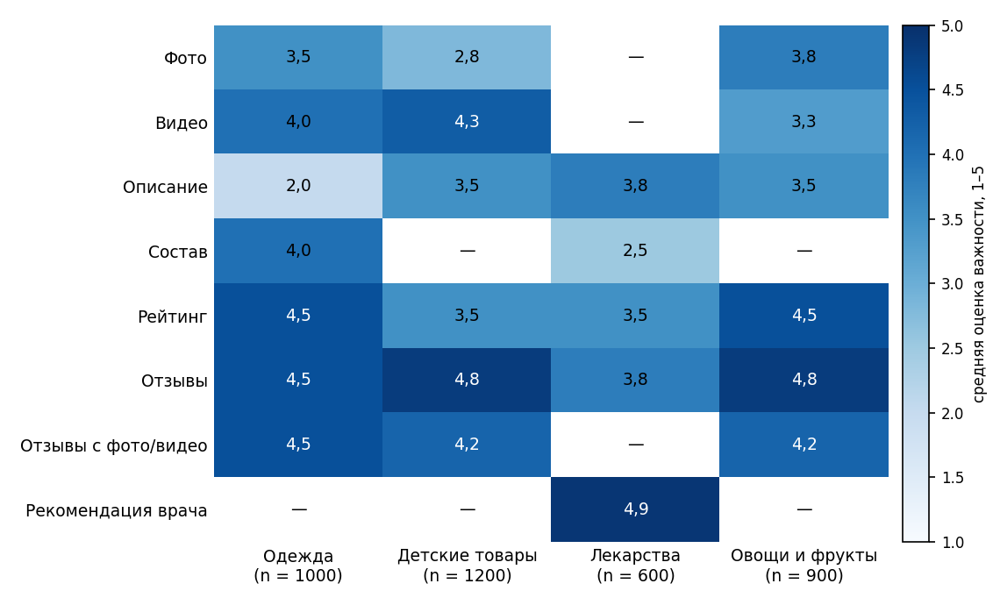
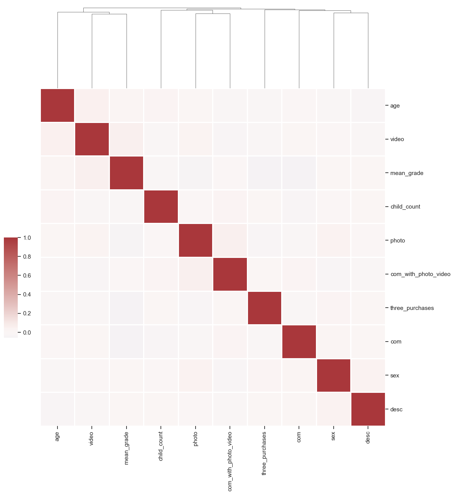

::: {.case-meta}
Проект, 2024 · Python (pandas, seaborn) ·
[таблица средних](https://github.com/wickedstacy085/wickedstacy085.github.io/blob/main/projects/consumer-survey/mean_ratings.csv)
:::

::: {.result-box}
**Аннотация.** Какие элементы карточки товара важнее всего покупателям в разных категориях?
Респонденты оценивали важность фото, видео, описания, состава, рейтинга и отзывов по шкале от 1 до 5.
Во всех категориях, кроме лекарств, выше всего оценены отзывы (4,5–4,8). В лекарствах
решает рекомендация врача (4,9), а состав почти не важен (2,5). Описание товара важно меньше всего
для одежды (2,0).
:::

## Данные

Четыре файла, по одному на категорию: одежда (1000 анкет), детские товары (1200), лекарства (600),
овощи и фрукты (900). В каждом — возраст, пол, признак постоянного покупателя (3+ покупки) или
специфичный признак категории (хроническое заболевание, аллергия, число детей) и оценки важности
элементов карточки. Набор вопросов в категориях разный, поэтому в таблице есть пропуски.

## Что получилось по сегментам

- **Одежда.** Важнее всего отзывы, отзывы с фото и видео и рейтинг (4,5). У постоянных покупательниц
  картина та же. Заметной разницы между мужчинами и женщинами нет.
- **Детские товары.** Отзывы (4,8), видео (4,3), отзывы с фото и видео (4,2); фото — 2,8.
  Это совпадает и для матерей с тремя и более покупками.
- **Лекарства.** Рекомендация врача (4,9), затем описание и отзывы (3,8). У покупателей с
  хроническими заболеваниями (62% выборки, в основном 40–60 лет) порядок тот же.
- **Овощи и фрукты.** Отзывы (4,8) и рейтинг (4,5). У людей с аллергией (70% выборки) оценки
  такие же.

## Ограничения

{width=65%}

- Корреляции между всеми признаками, включая возраст, близки к нулю, а средние круглые (3,5; 4,0;
  4,5). Похоже, данные синтетические, и выводы о сегментах на них стоит проверять осторожно.
- Сравнение возрастных групп в исходном ноутбуке строилось на суммах оценок по каждому возрасту.
  Сумма растёт вместе с числом ответов, поэтому сравнивать нужно средние или медианы, а для
  проверки разницы — тест Манна–Уитни.
- Пол закодирован 0 и 1 без расшифровки в данных; «0 — женщины» — допущение.

## Что из этого следует для карточки товара

Одна таблица «категория × элемент карточки» (как выше) даёт три рекомендации: в одежде и продуктах
просить у покупателей отзывы с фото, в детских товарах — видео, в лекарствах — показывать
сведения о назначении врачом и инструкцию, а не состав.
